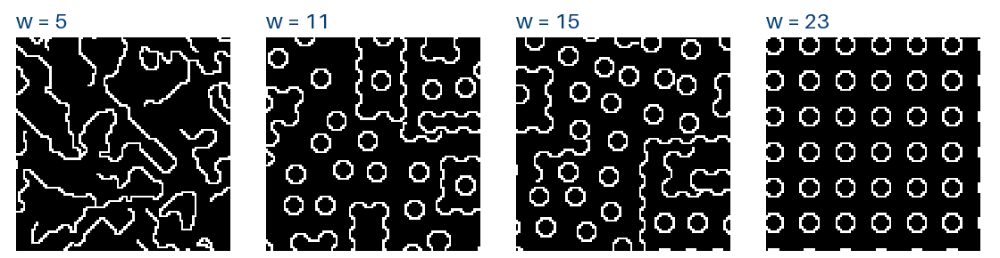
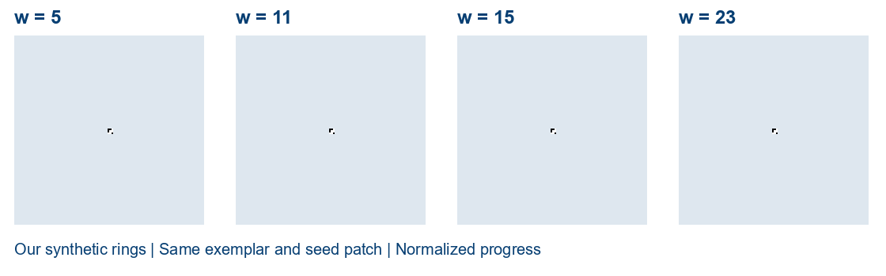

# CE7491 texture synthesis codebase

A small, independent Python reproduction of **Texture synthesis by non-parametric sampling** (Efros & Leung, ICCV 1999).

The implementation grows an image one pixel at a time. It matches the known target neighborhood against an exemplar, samples uniformly from near-best source locations, and copies one center pixel. It supports grayscale synthesis and hole filling, and records every committed decision for playback.



These are our executed outputs on a generated ring exemplar, with window widths 5, 11, 15, and 23. Larger context preserves more organization on this example. This is an educational reproduction, with documented implementation choices, rather than exact replication of the paper's figures.

## Quick start

Python 3.11 or newer, NumPy, and Pillow are sufficient. No GPU, training corpus, or model weights are needed.

```bash
python -m venv .venv
# Linux/macOS: source .venv/bin/activate
# Windows PowerShell: .venv\Scripts\Activate.ps1
python -m pip install -r requirements.txt
python check_implementation.py
python run_experiments.py --synthetic-only
```

The synthetic suite runs offline and writes results to `output/experiments/`. It compares four window sizes and three RNG seeds at w=11. A quick smoke run is:

```bash
python run_experiments.py --synthetic-only --size 24 --windows 5 --out output/smoke
```

To synthesize from your own exemplar:

```bash
python efros_leung.py path/to/texture.png output/custom --window 11 --size 96 --seed 7
```

## Original exemplar experiments

Download the optional images from the authors' public page, then run the full ten-experiment suite:

```bash
python download_examples.py
python run_experiments.py
```

The download script obtains `D1.gif` and `bread.gif`, verifies that they decode, and records their source URLs and SHA-256 hashes. It reuses files already present. Downloads live in the ignored `data/` directory. They are not included in this repository's license.

If the author server is unavailable, download [D1.gif](https://people.eecs.berkeley.edu/~efros/research/NPS/images/D1.gif) and [bread.gif](https://people.eecs.berkeley.edu/~efros/research/NPS/images/bread.gif) in your browser, place them in `data/`, and rerun the downloader to verify and record them. The synthetic suite works without these files.

The full suite adds D1 at w=11 and w=23, bread synthesis, and a 784-pixel hole in bread. For hole filling, a separate known exemplar crop excludes the hidden target pixels. All known target pixels remain fixed. The exact ten-run setup and measured results are in [docs/experiments.md](docs/experiments.md).

## Recorded growth

```bash
python make_demos.py output/experiments/rings_w11.npz --output output/rings_growth.gif
python make_demos.py output/experiments/bread_hole.npz --output output/hole_growth.gif
```

The second command requires the full suite. GIFs reconstruct actual committed-pixel order at normalized progress and hold the final state. Playback duration is independent of computation time. Rendering uses Pillow's bundled font, with no Windows font or presentation-folder dependency.



The bundled sweep was generated from the original teaching runs. The portable GIF helper generates a single-run animation from any saved NPZ.

## Algorithm and explicit choices

- Grayscale values normalized to [0,1].
- Gaussian weights with sigma w/6.4.
- Weighted SSD over known neighbors, normalized by their total Gaussian weight. Unknown entries and the target center are excluded.
- Candidate locations satisfy `distance <= 1.1 * minimum_distance`; selection is uniform over locations, not distinct brightness values.
- Absolute acceptance threshold starts at 0.3 and increases by 1.1 after an entire no-progress pass.
- An 8-connected boundary grows from a 3×3 seed. Boundary pixels are randomized, then stably sorted by decreasing known-pixel count in their context.
- Only fully supported source windows are searched. This is our explicit source-edge policy.
- Hole filling uses a binary known mask, independent of brightness.

The basic forward procedure retains earlier commitments. It is a heuristic, not proven exact sampling from a globally consistent MRF. It can lose long-range structure or copy a source region. Large windows can cost more and reduce available alternatives. Colour synthesis, backtracking, accelerated search, and semantic completion are outside this implementation's scope.

The direct exhaustive matcher costs approximately `O(output_pixels * source_windows * window_area)`, before retries and bookkeeping. Source windows are cached and distances vectorized, so both memory use and runtime grow with source size and context width.

## Files and verification

`efros_leung.py` contains the matcher, growth procedure, hole-filling API, and a single-image CLI. `check_implementation.py` checks hand-computed masked SSD, unknown/center exclusion, candidate membership, context counts, seeded determinism, completion, and known-pixel preservation. GitHub Actions runs these checks and a small offline experiment on Python 3.11 and 3.12 after you push.

Each run writes source, initial, and output PNGs, settings/timing JSON, and an NPZ containing `source`, `output`, `initial`, `known`, and `decisions`. A decision row contains target row/column, brightness, source row/column, minimum error, selected error, candidate count, and acceptance threshold. `experiment_manifest.json` indexes the runs, and `environment.json` records the execution environment.

## Sources and license

The code is an independent implementation from the [paper](https://doi.org/10.1109/ICCV.1999.79038) and [author pseudocode](https://people.eecs.berkeley.edu/~efros/research/NPS/alg.html). Third-party implementations were reviewed during preparation but their code was not incorporated. The [author page](https://people.eecs.berkeley.edu/~efros/research/EfrosLeung.html) supplies the optional exemplars.

The independent code and synthetic examples use the [MIT license](LICENSE). Original paper figures, slides, author images, and third-party repository copies are not distributed here. Please cite Efros and Leung when discussing the algorithm; citation metadata is in `CITATION.cff`.

